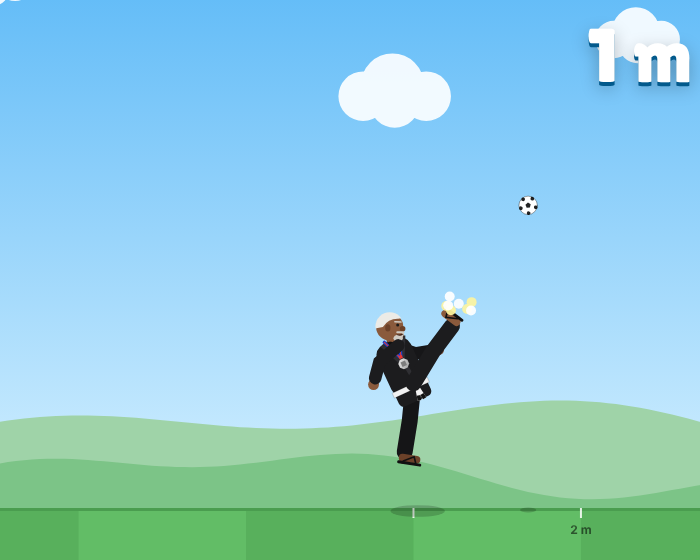

# Eggers Kick Off ⚽

A multiplayer remake of the classic Miniclip "kick for distance" game. **Jason** juggles the ball,
you time the kick, and the ball flies toward the **Click Wise Design Office** at 4,000 m — and
beyond. There's no finish line: it's scored like **Topgolf**, with targets all down the field.



## How it plays

- Jason juggles the ball off his knee to a random height each time. **Click, tap or press any
  key** to swing. His foot meets the ball 6 frames later, so you have to read the bounce.
- Strike it in the **sweet spot** (chest–head height) for a PERFECT kick: about 900 m to the
  first bounce, like the original. Too high = whiff. Too low = weak line drive.
- **Bounce pads** launch the ball on, **puddles** kill it, and **wind** pushes it around.

### Scoring (Topgolf-style)
- 1 point per 10 m.
- Stop the ball inside a target for bonus points: outer ring ×1, inner ×2, **bullseye ×3**.
  Targets: Coffee Cup (150 m), Car Park, Duck Pond (home of **Henry** 🪿), Water Tower, Pizza Shack, Billboard,
  Gas Station, **Click Wise Design Office (4,000 m, 250 pts)**, Downtown, Airport, Mountain Peak, Ski Lodge,
  Satellite Dish, Lighthouse, Volcano, Rocket Launch Pad, Moon Base, then Desert Oasis → Pyramids → Pirate Cove →
  Castle → Wind Farm → Glacier → Stadium → Space Elevator → Mars Colony → Black Hole → **Eggers Galaxy HQ (68 km,
  25,000 pts)**, then a Frontier Beacon every 8 km out to 152 km. Long kicks replay in ~10 seconds.
  The map is spaced to match what each upgrade tier can reach.
- A round is 10 kicks, and the **last ball scores double**.

### Progression
- **Coins** are paid after every kick (1 per 8 points; Free Kick 1 per 10), plus a 20-coin round completion bonus,
  a **daily streak** bonus (50 × streak, max 350), level-up bonuses, 22 one-time **milestones** and Career boss bounties.
- **Grind rewards:** 🔥 combos (consecutive GREAT/PERFECT kicks, up to ×3 coins), 🌟 Golden Balls (1 in 8, ×4 coins),
  🎖️ a veteran bonus (+1% coins per level above 10, max +150%) and a 🎁 Kick Crate after every round.
- **Power Balls:** 5 PERFECT kicks in a row load a random Power Ball for the next kick: 🔥 Fireball (+35%), 🏀 Super Bouncy (+25%, tall bounces), ☄️ Meteor (+45%, craters) or 🧲 Magnet (pulls a nearby stop into the bullseye). Decided by the ball's seed and the round's kick history, so the server re-simulates them exactly (`P.powerBallFor`). Bump `RULES_VERSION` in `shared/physics.js` whenever kick rules change.
- **Daily & weekly challenges** with goals scaled to each player's bests (landmark challenges pick spots in your range).
- Prices are built for a long grind: each upgrade level costs 1.6× the last (maxing everything ≈ 284k coins) and
  cosmetics run up to 100k.
- Every round's points also count as **XP**. Something new unlocks at almost every level up to 30.
- **Upgrades** go to **level 50**: Power Boots, Pro Ball, Sweet Spot Training, Slow-Mo Focus, Aero Laces, Lucky Socks.
  Levels 1–10 cost 1.6× per level; from 11 on each level costs 3.5% more (all six to 50 ≈ 9.7M coins).
- **Prestige ⭐:** at 150 total upgrade levels (+30 per prestige, capped at all-maxed) players can reset upgrades and
  coins for a permanent +10% coins and +2% kick power per prestige, a ⭐ by their name and prestige-only gear.
  Level, cosmetics, milestones, Career and records are kept. Prestige power is applied server-side.
- **Cosmetics:** outfits (Jason's black gi is the default, plus the white competition gi, the
  Black Belt Promotion, the Click Wise tee/polo, suit, Hawaiian, astronaut…), balls (including the Eggers
  Egg) and trails.

### Modes
| Mode | Online? | Notes |
|---|---|---|
| **Play Online** | ✅ | Ranked 10-kick round. Counts for the leaderboards. |
| **Career** | ✅ / ❌ | Wii Sports-style ladder of 12 bosses in 4 tiers. Head-to-head on the same 10 balls; bosses scale their gear to your upgrades, and every loss costs skill. Wins raise your Skill Level; reach **1,000 to go PRO** and earn the **Mastery Pro Ball**. Server-verified when signed in, local when offline. |
| **Multiplayer Room** | ✅ | 4-letter room code or invite link. Everyone gets the same 10 juggles, wind and field, with live standings and chat. The host can turn on "level playing field" (no upgrades). |
| **Challenge a friend** | ✅ | Share a link. Your friend plays your exact 10 kicks to try to beat your score. Leaderboard rows have "Beat it" buttons too. |
| **Casual Round** | ❌ | Offline 10-kick round with its own local progress. |
| **Free Kick** | ❌ | Endless offline practice that earns coins per kick. |

Leaderboards: **Best Round**, **This Week**, **Longest Kick** (with replays you can watch).

Offline play works with no connection: a service worker caches the game after the first visit.

## Patch notes
Players see patch notes from the **📰 Patch notes** link on the menu. They open automatically for returning players
when there's a new version. To publish notes for a release, add an entry to the top of `public/js/patchnotes.js`
(with a new `version`) and bump `CACHE` in `public/sw.js` so offline players get the update.

## Anti-cheat
Physics are deterministic and shared by the browser and the server (`shared/physics.js`). The
client only sends *which frame the player kicked on*. The server re-simulates the kick from the
round's secret-until-started seed, using the player's server-side upgrades, and scores it
itself. Nobody can post a fake distance.

## Deploy on Railway

1. Push this folder to a GitHub repo.
2. In Railway: **New Project → Deploy from GitHub repo** → pick the repo.
   Railway detects Node and runs `npm start` (see `railway.json`, which also sets the
   `/api/health` health check).
3. Add a database: **+ New → Database → PostgreSQL**. Then, on the game service, go to
   **Variables → Add Reference → `DATABASE_URL`** from the Postgres service. Tables are created
   automatically on boot.
4. **Settings → Networking → Generate Domain** to get a public URL (or add your own domain,
   e.g. `kick.clickwisedesign.com`).

That's it: WebSockets work out of the box on Railway.

> Without `DATABASE_URL` the server falls back to a JSON file in `./data` (or `DATA_DIR`).
> That's fine locally, but on Railway the file is wiped on every deploy unless you attach a
> volume and point `DATA_DIR` at it. Use Postgres.

### Keeping player progress safe
- **Postgres is required in production.** On Railway (or with `NODE_ENV=production`) the server refuses to start
  without `DATABASE_URL`, so a misconfigured deploy fails its health check and Railway keeps the previous version running.
  (Set `ALLOW_EPHEMERAL_STORAGE=true` only for throwaway test deploys.)
- **Device backups:** every profile response includes a signed (HMAC) snapshot of the player's online and career
  progress, which the browser keeps. If the server ever loses a profile, the game restores it automatically.
  Snapshots can't be edited without breaking the signature.
- **Set `PROFILE_SECRET`** (any long random string) on the Railway service. Without it, the signing key lives in the
  database, which is fine until the database itself is replaced. With it, backups survive even that.
- **Logins:** players can set a password in Profile and log in by kicker name on any device.

Environment variables:

| Var | Default | Purpose |
|---|---|---|
| `PORT` | 3000 | Set by Railway automatically |
| `DATABASE_URL` | – | Postgres connection string (recommended) |
| `DATA_DIR` | `./data` | JSON-file storage location when no database |
| `PGSSL` | – | Set to `disable` if your Postgres doesn't use SSL |
| `PROFILE_SECRET` | stored in DB | Signing key for progress backups — set it so backups survive a database replacement |
| `ALLOW_EPHEMERAL_STORAGE` | – | `true` lets a hosted server run without a database (data is lost on deploy!) |
| `ADMIN_TOKEN` | – | Long random string that unlocks the moderation endpoints (see `store/MODERATION.md`) |
| `ANDROID_PACKAGE` | `com.clickwisedesign.eggerskickoff` | Android app id for `/.well-known/assetlinks.json` |
| `ANDROID_SHA256` | – | Play app-signing SHA-256 fingerprint(s), comma-separated; makes the Android app full-screen |
| `APP_ORIGINS` | – | Extra origins allowed to call the API (Capacitor's are built in) |

## Phone apps (Google Play & App Store)

Everything for the stores lives in [`store/`](store/README.md): checklists, listing copy, privacy
and rating answers, icons, screenshots, the Android (TWA) config and the iOS (Capacitor) steps.
`npm run build:app` bundles the game into `app-dist/` for the iOS app. Players can also install the
website as an app today with the **📲 Install app** button (Android/desktop) or Share → Add to Home Screen (iPhone).

## Run locally
```bash
npm install
npm start          # http://localhost:3000
npm test           # physics, scoring, shop, full API + multiplayer room tests
```

## Project layout
```
shared/physics.js   deterministic juggle/kick/flight simulation + Topgolf scoring (client & server)
shared/catalog.js   upgrades, cosmetics, levels, coin rewards, milestones (client & server)
shared/career.js    Career bosses, CPU kicks, skill level (client & server)
public/js/patchnotes.js  in-game patch notes
src/server.js       Express API + WebSocket rooms, live feed
src/store.js        Postgres store with JSON-file fallback
src/moderation.js   name/chat word filter (players can also report & block)
scripts/build-app.js  bundles the game for the iOS/Android app shells
store/              app store prep kit (see store/README.md)
public/js/render.js canvas renderer (Jason, field, targets, landmarks, office)
public/js/game.js   game loop & kick state machine
public/js/app.js    menus, shop, leaderboard, rooms, online/offline profiles
```

Accounts are lightweight: pick a kicker name and the browser keeps a secret token. Players can
copy a **transfer code** from their profile to continue on another device.
